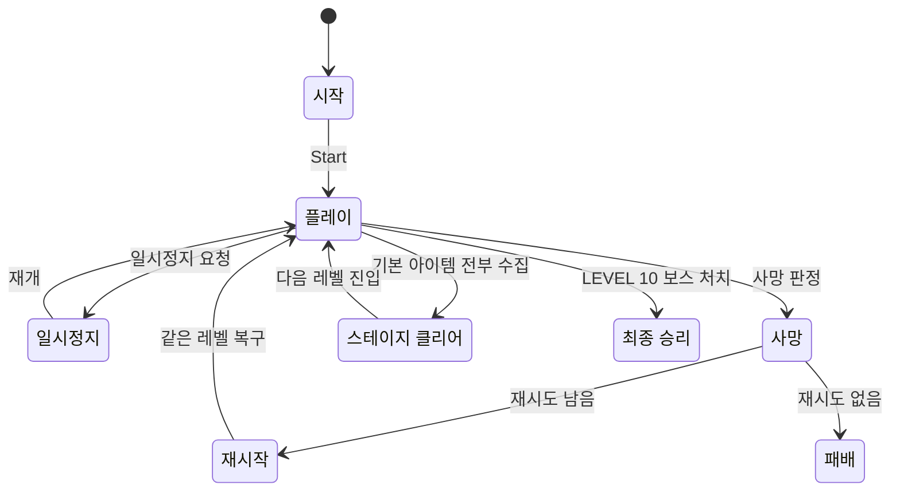

# 마법의 성 플레이 규칙 보완

[기존 기능 명세서](../../GAME_SPEC.md)를 기준으로 캐릭터 동작, 적 AI, 충돌, 상태 전환을 구체화한다. 맵과 오브젝트 위치는 [스테이지 배치 명세](STAGE_LAYOUTS.md)를 따른다.

| 표시 | 의미 |
| --- | --- |
| **확인** | 원작 도움말에 명시됐거나 영상에서 직접 관찰한 내용이다. |
| **추정** | 프레임에서 측정한 근삿값 또는 여러 장면에서 도출한 해석이다. |
| **미확인** | 현재 자료로 원작의 동작이나 값을 특정할 수 없다. |
| **구현안** | 구현 시 동작을 명시하기 위한 설계 초안이다. 원작과 다를 수 있는 항목은 승인 또는 추가 검증이 필요하다. |

## 1. 캐릭터 애니메이션과 행동

### 머다냥

| 동작 | 확인한 외형과 행동 | 전환 기준 구현안 |
| --- | --- | --- |
| 대기 | **확인** LEVEL 시작 위치에서 발을 바닥에 둔 채 서 있다. 대기 프레임 수와 반복 모션은 **미확인**. | 지면에 있고 수평 이동이 멈추면 대기 자세를 표시한다. 마지막 좌우 방향을 유지한다. |
| 걷기 | **확인** 좌우 이동에 따라 보는 방향이 바뀐다. **추정** 보행 속도 약 `260 좌표 단위/초`. | 지면에서 `←` 또는 `→`에 의해 실제 수평 이동이 발생하는 동안 걷기 모션을 반복한다. |
| 사다리 오르기·내리기 | **확인** 사다리에서 등과 팔을 보이는 자세로 바뀌고 수직으로 이동한다. **추정** 오르기 표본 약 `310 좌표 단위/초`. 하강 속도와 자세 재사용 여부는 **미확인**. | 사다리 탑승 중 `↑` 또는 `↓`로 이동할 때 승강 모션을 반복한다. 입력을 놓으면 현재 위치에서 모션을 멈춘다. 연결 층에 내려서면 대기 또는 걷기로 전환한다. |
| 점프 | **확인** `Space`가 점프 키다. 같은 층에서 발이 뜨며 이동 방향으로 틈을 넘는 장면이 있다. 정확한 최고 높이, 체공 시간, 입력 유지 효과는 **미확인**. | 지면에서 점프 입력을 받으면 상승·하강 자세를 표시한다. 다시 지면에 닿으면 대기 또는 걷기로 전환한다. |
| 발판 이탈과 사망 | **확인** 틈을 통해 낙하하는 동안 정면 자세가 보이며, 사망 장면에는 넘어진 자세와 머리 위 별 효과가 나온다. **미확인** 모든 사망 원인에 같은 모션을 쓰는지와 연출 길이. | 낙하 중에는 낙하 자세를 표시한다. 사망 상태로 들어가면 사망 모션을 한 번 재생하고 종료 시 재시작 또는 패배로 전환한다. |

속도는 [플레이 관찰 기록의 프레임 측정](../02_reference/PLAY_OBSERVATIONS.md#이동-속도-측정)을 따른다. 원작의 속도 상수, 스프라이트 프레임 수와 재생 주기는 미확인이다. 애니메이션과 이동 판정은 별도로 관리한다.

### 그 밖의 등장인물

| 캐릭터 | 확인한 역할과 행동 | 미확인 사항 |
| --- | --- | --- |
| 뽀야공주 | **확인** 도움말에 등장하는 구출 대상. | 인게임 조작, 대기·이동 모션, 구출 장면. |
| 보리마법사 | **확인** LEVEL 10의 보스. 도움말에 위에서 돌을 떨어뜨리는 공격이 나온다. | 이동·공격·피격·패배 자세, 공격 주기, HP와 필요한 명중 횟수. |
| 선택형 플레이어 3종 | **확인** 프로젝트 로드맵에 3종과 선택 기능이 들어 있다. 영상의 `Start` 다음에는 머다냥 플레이가 시작된다. | 머다냥 외 두 캐릭터의 이름과 원작 선택 기능 유무. 공주와 보스를 선택 가능한 캐릭터로 볼 근거는 현재 없다. |

## 2. 몬스터 AI

속도는 [배치 명세의 좌표계](STAGE_LAYOUTS.md#좌표와-오브젝트-기준)에서 환산한 관측 표본이다. 방향 전환을 한 사례와 전환을 일으키는 규칙은 별개로 기록한다.

| 몬스터 | 등장·이동 확인 | 속도 추정 | 방향 전환·추적 미확인 |
| --- | --- | --- | --- |
| 꼬꼬야 | LEVEL 1에서 상자 개봉 뒤 같은 층에서 좌우 이동. 플레이어가 다른 층에 있을 때에도 수평 이동한다. | 약 `130 단위/초` | 최초 이동 방향, 반전 좌표와 조건, 틈·사다리 처리, 플레이어 추적. |
| 이야 | Character 도움말에서 외형과 이름을 확인했다. | 미확인 | 등장 스테이지, 이동 방향, 반전, 사다리와 추적, 공격 모션. |
| 빠지 | LEVEL 1·2의 상자 개봉 뒤 출현 사례와 LEVEL 3의 초기 출현을 확인했다. LEVEL 3에서 같은 높이로 이동하며 발판 틈 위를 통과하고 방향을 바꾼다. | 약 `120 단위/초` | 정확한 반전 좌표, 전체 이동 범위, 사다리 사용, 플레이어 추적. |
| 비암 | Character 도움말에서 외형과 이름을 확인했다. | 미확인 | 등장 스테이지, 이동 방향, 반전, 사다리와 추적, 공격 모션. |
| 두지 | LEVEL 1의 상자 개봉 뒤 오른쪽에서 왼쪽으로 움직인다. 첫 발판의 틈 안쪽에서도 같은 높이가 유지된다. | 약 `130 단위/초` | 최초 이동 방향, 반전 조건, 사다리 사용, 플레이어 추적. |
| 보리마법사 | LEVEL 10의 처치 대상이다. | 미확인 | 초기 위치, 이동과 반전, 추적, 공격 패턴, 피격 후 동작. |

**구현안** 관찰한 일반 적은 등장 층에서 좌우 이동하는 상태를 기본으로 두고, 속도와 방향 전환 범위를 배치마다 지정할 수 있게 한다. 빠지와 두지는 확인된 틈 구간에서 해당 층의 높이를 유지한다. 위치, 속도, 반전, 사다리, 추적 값이 미확인인 적은 추가 자료 또는 설계 결정으로 확정한다. 관련 장면은 [플레이 관찰 기록](../02_reference/PLAY_OBSERVATIONS.md)을 참조한다.

## 3. 충돌 판정

| 대상 | 확인·추정·미확인 | 판정 기준 구현안 |
| --- | --- | --- |
| 발판과 바닥 | **확인** 발판 윗면에서 걷고, 틈을 점프로 넘으며, LEVEL 1·3에서 틈 낙하 뒤 사망한다. 아래층 발판에 착지할 수 있는 조건과 측면·아랫면의 판정은 **미확인**. | 하강 중 `이전 발 y ≤ 발판 y ≤ 새 발 y`이고 발 중심 x가 발판 구간 안이면 착지한다. 낙사로 확인된 틈에서 지지면을 잃으면 아래층 착지 없이 낙하하고 바닥 도달 시 사망으로 전환한다. |
| 사다리 | **확인** 사다리와 연결된 층에서 위아래로 이동한다. 진입 허용 폭, 공중에서 진입하는 조건, 도중 이탈 조건은 **미확인**. | 사다리의 양쪽 기둥 사이에 발 중심이 들어오고 연결 끝점에서 `↑` 또는 `↓`를 누르면 탑승한다. 탑승 중 수평 이동과 중력은 멈추고, 목표 층 높이에 도달하면 다시 발판에 선다. |
| 기본 아이템 | **확인** 플레이어와 닿은 뒤 아이템이 사라지고 우측 목록과 점수가 갱신된다. 체리·포도·초록 병은 각 30점. 실제 판정 범위는 **미확인**. | 플레이어 몸체와 아이템의 접촉 영역이 겹칠 때 해당 인스턴스를 한 번만 처리한다. 획득 목록과 SCORE를 갱신하고, 남은 기본 아이템이 0개면 클리어로 전환한다. |
| 상자·LIFEUP | **확인** 플레이어가 닿을 때 상자가 열리고, LIFEUP 획득 문자는 왼쪽에 표시된다. 상자 판정 폭, 특수 효과 유지, 문자 중복·사망 처리는 **미확인**. | 접촉 영역이 겹칠 때 같은 상자를 시도당 한 번만 개봉한다. 문자는 개별 기본 아이템 수에서 제외한다. |
| 일반 몬스터 | **미확인** 접촉 즉사 여부, 위에서 밟기, 사다리·점프 중 피격, 상자 출현 직후 무적과 판정 크기. | 같은 화면의 두 몸체 충돌 영역이 실제로 겹칠 때 접촉 후보를 발생시킨다. 적 종류와 공격 상태에 따른 효과는 검증 항목으로 둔다. 시각적으로 x만 일치하는 다른 층은 접촉에 해당하지 않는다. |
| 횃불 | **확인** 불꽃이 켜졌다 꺼지는 장면과 LEVEL 1에서 횃불 근처 사망이 보인다. **추정** 횃불은 피해를 주는 장애물이다. 활성 구간과 몸체·불꽃 중 판정 대상은 **미확인**. | 배치 데이터에 횃불을 개별 오브젝트로 둔다. 충돌과 점멸 주기는 추가 관찰 뒤 확정한다. |
| 마법칼과 돌 | **확인** 도움말에 금괴의 마법칼 효과와 LEVEL 10 위쪽에서 돌을 떨어뜨리는 공격이 나온다. 공격 범위·피해량·보스 피격 판정은 **미확인**. | 플레이어 접촉 판정과 공격 판정을 별개로 둔다. 무기 발동, 피해, 보스 승리 조건은 별도 규칙으로 확정한다. |

**구현안** 오브젝트의 충돌 영역은 스프라이트의 투명 여백을 제외한 직사각형에서 시작하고, 플레이어 발 중심과 접촉 몸체를 구분한다. 사망과 마지막 기본 아이템 획득이 같은 갱신에서 발생할 경우의 원작 우선순위는 **미확인**이다. 재현용 후보는 사망을 우선하고 해당 갱신에서 클리어 전환을 생략하는 방식이다.

## 4. 게임 상태와 전환

상태 이름은 플레이 흐름을 표현하기 위한 명세다. `재시작`과 `스테이지 클리어`는 한 번만 적용되는 전환으로, 별도 원작 화면이 확인된 경우에만 화면 연출을 붙인다.

| 전환 | 동작과 데이터 처리 | 근거 |
| --- | --- | --- |
| 시작 → 플레이 | `Start`로 새 게임을 시작한다. LEVEL 1, SCORE 0, 활성 LIFE 2개, 초기 맵과 플레이어 시작 위치를 적용한다. | **확인** 타이틀과 첫 플레이 화면. |
| 플레이 ↔ 일시정지 | 일시정지 입력을 받을 때 같은 레벨의 위치, SCORE, LIFE, 아이템 상태를 유지하며 입력·물리·AI·타이머 갱신을 멈춘다. 재개하면 같은 위치에서 진행한다. | **구현안** 원작의 일시정지 지원, 입력과 화면은 **미확인**. |
| 플레이 → 사망 | 틈에서 떨어져 사망한 뒤 사망 연출이 나온다. 한 번의 사망은 전환을 한 번만 일으킨다. | 낙사와 연출 **확인**. 중복 전환 방지는 **구현안**. |
| 사망 → 재시작 → 플레이 | 사망 시 활성 LIFE가 1개 이상이면 1개 소모하고 같은 레벨 시작 위치에서 재개한다. 기본 아이템·상자와 우측 기록을 초기화하고 SCORE를 유지한다. | **확인** LEVEL 1 반복 플레이. LIFEUP 및 특수 아이템 유지 규칙은 **미확인**. |
| 사망 → 패배 | 사망 직전 활성 LIFE가 0개이면 `YOU LOSE`를 표시한다. 영상에서 패배 뒤 LEVEL 1, SCORE 0인 새 게임이 시작된다. | **확인** 패배와 새 게임. 패배 화면을 빠져나가는 키 또는 대기 시간은 **미확인**. |
| 플레이 → 스테이지 클리어 → 플레이 | 마지막 기본 아이템의 점수를 반영하고 LEVEL을 1 증가시킨다. LIFE와 SCORE를 유지하고 다음 레벨의 맵과 아이템을 배치한다. 오른쪽 기본 아이템 기록은 비우고, LIFEUP 문자는 레벨을 넘어 유지된 사례가 있다. | **확인** LEVEL 1→2와 2→3. |
| 플레이 → 최종 승리 | LEVEL 10의 보리마법사를 처치하면 승리한다. | **확인** 도움말의 공격 방식과 게임조선의 승리 조건. 아이템 요구 여부, 승리 화면, 메뉴 복귀 방법은 **미확인**. |

## 5. 재현 확인 기준

| 상황 | 기대 결과 | 근거 상태 |
| --- | --- | --- |
| 왼쪽 걷기에서 정지한 뒤 오른쪽으로 걷고 사다리를 오른다. | 좌우 모습이 바뀌고, 사다리에서는 등과 팔을 보이는 자세가 나온다. | **확인** 외형과 이동. 정지 프레임은 **구현안**. |
| LEVEL 3 빠지가 가운데 틈을 통과한다. | 플레이어가 다른 층에 있어도 빠지는 같은 높이에서 틈 위를 통과한다. | **확인** 관찰 구간 기준. |
| LEVEL 1 맨 아래 체리와 첫 발판의 포도를 차례로 획득한다. | 기본 아이템은 각각 한 번만 사라지고 SCORE는 `0 → 30 → 60`이 된다. | **확인**. |
| LEVEL 1에서 LIFE 1개로 사망한 뒤 재시작해서 다시 사망한다. | 첫 사망에서 LIFE 0개로 같은 레벨을 재개한다. 그다음 사망에서 `YOU LOSE`가 나온다. | **확인**. |
| LEVEL 2의 마지막 포도를 획득한다. | LEVEL 3으로 바뀌고 이전에 얻은 `I`는 좌측에 남는다. 우측 수집 목록은 새로 시작한다. | **확인**. |
| 사다리 이동 중 일시정지와 재개를 실행한다. | 재개 전까지 캐릭터와 적의 위치를 유지하고, 재개하면 같은 위치에서 이어진다. | **구현안**. |

## 추가 확인이 필요한 사항

1. LEVEL 4~10 전체 플레이 또는 각 레벨 첫 화면. LEVEL 10은 돌을 떨어뜨리는 위치, 보스 공격과 피격, 승리 화면까지 필요하다.
2. 원작에서 머다냥 외 플레이어 선택이 있었는지와 프로젝트에서 의도한 3종의 구성. 로드맵의 5종 악당에 최종 보스를 포함하는지도 확인한다.
3. 횃불과 적에 닿았을 때의 사망 조건, 횃불이 꺼진 동안의 통과 가능 여부, 원작 일시정지 조작. 해당 장면이나 조작 안내가 있으면 판정 규칙을 확정할 수 있다.
